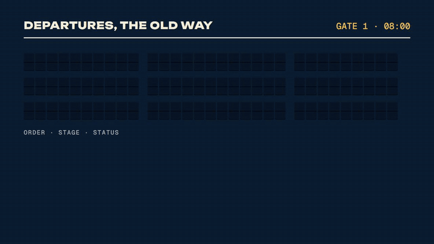

<p align="center">
  
</p>

<h1 align="center">INDOTECH Dispatch Management System</h1>

<p align="center">
  <strong>Follows every Indo Tech transformer from work order to the factory gate, covering packing lists, loading lists, vehicle entry and exit, and dispatch slips, with five user roles.</strong>
</p>

<p align="center">
  
  
  
  
</p>

- Create and approve work orders with MVA and voltage specs, then follow each one on a live, shift-wise dashboard.
- Build packing lists item by item, and copy items between work orders.
- Loading lists fill in from packed items, ready to assign to a container or truck.
- Security staff log vehicle entry and exit at the gate, with details filled in from the work order.
- Print dispatch slips and export reports to CSV, filtered by date and status.

## See it in 30 seconds

<a href="docs/film/dispatch.mp4">
  <picture>
    <source media="(prefers-color-scheme: dark)" srcset="docs/film/dispatch-dark.gif">
    <source media="(prefers-color-scheme: light)" srcset="docs/film/dispatch-light.gif">
    
  </picture>
</a>

<p align="center"><sub>Dispatch Management in 30 seconds. The preview plays silently with subtitles; <a href="docs/film/dispatch.mp4">open the MP4</a> for the narrated version with music.</sub></p>

## Quick start

```bash
git clone https://github.com/KRISH-exe-29/Dispatch-ITTL.git && cd Dispatch-ITTL
npm install
cp .env.example .env    # add your Supabase URL and anon key
npm run dev             # http://localhost:5173
```

You need a Supabase project with the tables listed under **Database Setup** below.

---

## 📋 Overview

The **INDOTECH Dispatch Management System** is a full-stack web application designed for **Indo Tech Transformers Limited (ITTL)** to manage the complete lifecycle of transformer dispatch operations — from work order creation through packing, loading, vehicle management, and final delivery.

Built with **React 19 + Vite** on the frontend and **Supabase** (PostgreSQL + Auth + RLS) on the backend, it provides role-based access control with five distinct user roles.

---

## ✨ Features

### 🔐 Role-Based Access Control
| Role | Access |
|------|--------|
| **Admin** | Full access — all modules, user management, reports, master lists |
| **Supervisor** | All operational modules — create, edit, delete work orders and items |
| **User** | Dashboard, work orders, packing, loading — view and add only |
| **Security** | Vehicle gate management — entry/exit tracking |
| **Dashboard User** | Read-only analytics dashboard |

### 📦 Core Modules
- **Dashboard** — Real-time KPIs, shift-wise analytics, work order progress tracking
- **Work Orders** — Create, edit, approve, and track transformer work orders with MVA/voltage specs
- **Packing List** — Item-level packing management with copy/paste between work orders, status cycling
- **Loading List** — Auto-populated from packed items, container/truck assignment
- **Vehicle Management** — Security gate entry/exit, auto-fill from work orders
- **Dispatch Slip** — Printable dispatch documentation
- **Reports** — Export data as CSV, filterable by date and status
- **Master List** — Centralized reference data (customers, vehicle types, transformer ratings)
- **User Management** — Admin-only user creation with role assignment

### 🎨 Design
- Dark-themed glassmorphism login page with role selection cards
- Professional light theme for operational pages
- Animated icons (Lottie + GIF) for edit, delete, approve, and view actions
- Modern toast notifications with progress bar and type-based styling
- Responsive layout with collapsible sidebar
- DM Sans typography throughout

---

## 🛠️ Tech Stack

| Layer | Technology |
|-------|-----------|
| **Frontend** | React 19, Vite 8, React Router 7 |
| **Backend** | Supabase (PostgreSQL, Auth, Row Level Security) |
| **Styling** | Vanilla CSS with CSS variables |
| **Icons** | Lucide React, Lottie animations, custom GIFs |
| **Auth** | Supabase Auth with role enforcement |
| **Hosting** | Local development (Vite dev server) |

---

## 📁 Project Structure

```
├── public/
│   └── Asserts/              # Logo, icons, animations (GIF, Lottie JSON, PNG)
├── src/
│   ├── assets/               # Bundled assets (loading animation)
│   ├── components/
│   │   ├── Layout.jsx        # Main layout with sidebar + header
│   │   ├── Sidebar.jsx       # Navigation sidebar
│   │   ├── SmartItemInput.jsx # Auto-learning item input component
│   │   └── ToastProvider.jsx  # Modern toast notification system
│   ├── lib/
│   │   ├── supabase.js       # Supabase client (with dev proxy)
│   │   ├── activityLogger.js # Activity audit logging
│   │   └── masterListLearning.js # Auto-learn from master list
│   ├── pages/
│   │   ├── Dashboard.jsx     # Analytics dashboard
│   │   ├── WorkOrders.jsx    # Work order CRUD
│   │   ├── PackingList.jsx   # Packing item management
│   │   ├── LoadingList.jsx   # Loading/container management
│   │   ├── Vehicles.jsx      # Vehicle gate management
│   │   ├── Login.jsx         # Role-based login
│   │   ├── Users.jsx         # User management (Admin only)
│   │   ├── Reports.jsx       # CSV export & reports
│   │   ├── MasterList.jsx    # Reference data management
│   │   ├── StuffList.jsx     # Miscellaneous items
│   │   ├── Email.jsx         # Email notifications
│   │   ├── DispatchSlip.jsx  # Printable dispatch slip
│   │   └── manager/          # Manager-specific views
│   ├── App.jsx               # Root component with routing
│   └── index.css             # Global styles
├── .env.example              # Environment variable template
├── vite.config.js            # Vite config with Supabase proxy
└── package.json
```

---

## 🚀 Getting Started

### Prerequisites
- **Node.js** 18+ and **npm**
- A **Supabase** project ([create one free](https://supabase.com))

### Installation

See [Quick start](#quick-start) above.

### Environment Variables

| Variable | Description |
|----------|-------------|
| `VITE_SUPABASE_URL` | Your Supabase project URL |
| `VITE_SUPABASE_ANON_KEY` | Your Supabase anonymous (public) key |

> ⚠️ **Never commit `.env` files.** The `.gitignore` is configured to exclude all environment files.

---

## 🗄️ Database Setup

The application requires the following Supabase tables:

| Table | Purpose |
|-------|---------|
| `profiles` | User profiles with role assignment |
| `work_orders` | Transformer work orders |
| `packing_items` | Individual packing list items |
| `loading_items` | Loading/container assignments |
| `vehicles` | Vehicle gate entry/exit records |
| `master_list` | Reference data (customers, types, ratings) |
| `activity_log` | Audit trail for all user actions |

Row Level Security (RLS) policies are configured per-role to enforce access control at the database level.

---

## 👥 Default Roles & Login Flow

1. User selects their role on the login screen (Supervisor, User, Dashboard User, Security)
2. Admin access is available via a discrete button in the top-right corner
3. After authentication, the system verifies the user's database role matches the selected login role
4. Mismatched roles are rejected with a clear error message
5. Security users are redirected directly to Vehicle Management

---

## 📄 License

This project is proprietary software developed for **Indo Tech Transformers Limited (ITTL)**.  
Unauthorized reproduction or distribution is prohibited.

---

<p align="center">
  <sub>Built with ❤️ for INDOTECH — Indo Tech Transformers Limited</sub>
</p>
